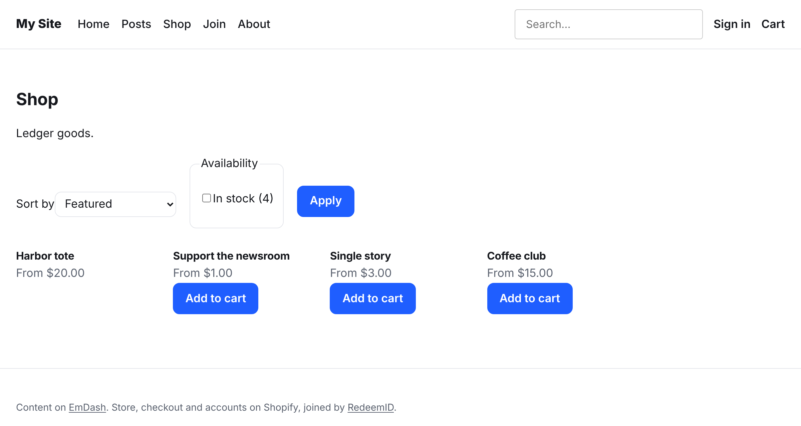
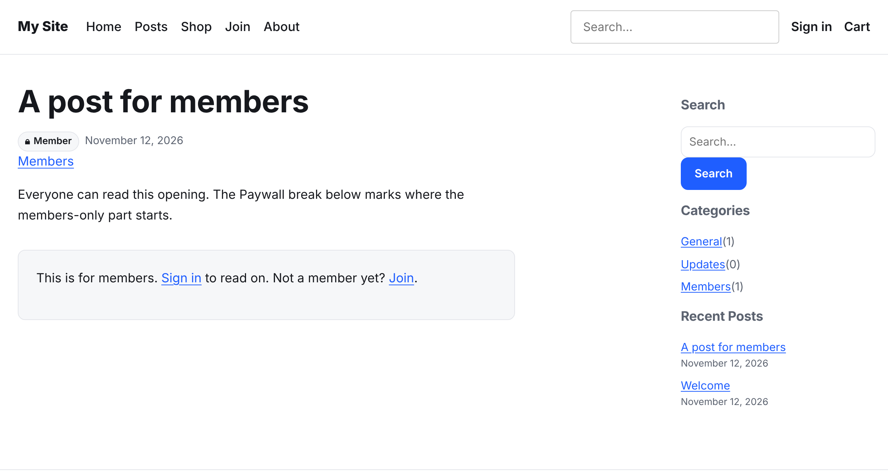

# RedeemID starter for EmDash

An [EmDash](https://github.com/emdash-cms/emdash) site on Cloudflare with Shopify commerce built in: a shop, product pages, a cart, Shopify checkout, store sign-in, and members-only posts.

Shopify runs the store, checkout, orders, subscriptions and customer accounts. EmDash runs the content. [RedeemID](https://github.com/webmultipliers/redeemid-emdash) joins the two, so readers shop and sign in on your own pages, and what they can read comes from their Shopify customer tags.

[](https://deploy.workers.cloudflare.com/?url=https://github.com/webmultipliers/redeemid-emdash-starter)





## What's in it

- **Shop:** `/shop/` lists a Shopify collection with Shopify's filters and sorting, `/shop/[handle]/` is a product page with options, subscriptions, recommendations and structured data, `/shop/search` searches the catalog, and `/cart` and a cart drawer lead to Shopify checkout.
- **Members:** readers sign in with the store's customer account. Posts in the **Members** category open only for customers tagged `member` in Shopify. Everyone else reads the opening, up to the Paywall break, and then a panel that asks them to sign in or join. `/join/` shows a plan card for each membership product, and `/account` shows the member's card, preferences and data.
- **Search engines:** product pages get the product's own title and description, unknown products answer 404, and `/sitemap-products.xml` lists every product page.
- **Admin:** RedeemID's pages under **Plugins → RedeemID** cover Setup, Access, Members, Webhooks, Reports, Status and more. Editors get Paywall break, Members only, Product, Collection and Plan blocks.
- **Look:** one small stylesheet, `src/styles/site.css`, with no framework. Change its tokens to rebrand, or replace it.

## Before you deploy: set up Shopify

The site needs a few values that only exist once Shopify is set up, so do this part first. It takes about twenty minutes. **Plugins → RedeemID → Setup** in the site's admin checks every step afterwards.

### 1. The store

- **Plan:** Shopify's **Basic** plan is enough to start. It includes the Headless channel, the new customer accounts and Shopify Flow.
- **Customer accounts:** in **Settings → Customer accounts**, use the new customer accounts (not legacy). Legacy accounts have no Customer Account API, so nobody could sign in.
- **Apps to install:**
  - [Shopify Flow](https://apps.shopify.com/flow) tags customers when they buy a membership, renew or cancel. RedeemID only reads tags, so Flow (or another app) is what grants and removes access. See the [Flow recipes](https://github.com/webmultipliers/redeemid-emdash/blob/main/docs/shopify-flow.md).
  - [Shopify Digital Products](https://apps.shopify.com/delivery) delivers downloads, such as e-books or audio files, after checkout.
  - [Headless](https://apps.shopify.com/headless), the sales channel for sign-in and the shop (step 3).
- **Your store's myshopify domain:** it's under **Settings → Domains**, such as `my-store.myshopify.com`. The site always needs this one, even after you add your own domains.

### 2. Domains

Your EmDash site lives on your own domain, such as `example.com`. Shopify serves checkout and customer accounts from its own pages, and you can put those on your domain too:

| What | Example | Where to set it |
| --- | --- | --- |
| The site (EmDash) | `example.com` | Cloudflare: your Worker → **Settings → Domains & Routes → Add → Custom domain**, after you deploy |
| The store (checkout, order status) | `shop.example.com` | Shopify: **Settings → Domains → Connect existing domain**, then make it the primary domain |
| Customer accounts (sign-in, orders, addresses) | `account.example.com` | Shopify: **Settings → Customer accounts → Domain** ([how](https://help.shopify.com/en/manual/domains/add-a-domain/connecting-domains/connect-domain-customer-account)) |

Both Shopify domains are optional, and you can add them later: sign-in and checkout follow them on their own, so nothing on the site changes. Keep the site's own domain off Shopify, since the Worker answers there. For each Shopify domain, add the DNS record Shopify shows (a `CNAME` to `shops.myshopify.com`) in Cloudflare's DNS with the proxy turned off (grey cloud).

### 3. Sign-in and the shop: a Headless storefront

1. In Shopify admin, open **Sales channels → Headless** and **Create storefront**. Name it after the site.
2. Open **Storefront API** and copy the **Private access token**. The shop, cart and checkout use it. The default permissions cover products, collections and carts.
3. Open **Customer Account API**, then **Application setup**, and fill in all three addresses with your site's domain:

   | Field | Value |
   | --- | --- |
   | **Callback URI(s)** (required) | `https://example.com/_emdash/api/auth/redeemid/callback` |
   | **JavaScript origin(s)** | `https://example.com` |
   | **Logout URI** | `https://example.com/` |

   Shopify only accepts `https` addresses. If the site isn't deployed yet, copy the values below now and come back to this step once you know its address: your domain, or the `*.workers.dev` address Cloudflare gives the Worker until you connect one.
4. Pick the **Client type**. **Public** has no secret. **Confidential** gives a client secret, which you then set on the site as well (step 5).
5. Copy the **Client ID**.

To sell, make your products and the collection the shop lists available to the **Headless** channel (on each product, **Sales channels**). The shop lists the **Home page** collection; to list another, change `COLLECTION` in `src/pages/shop/index.astro`.

### 4. Webhooks: a Shopify app

Shopify tells the site when a customer's tags change through webhooks, and they come from an app you create for your store. The site registers the webhooks itself, as long as the app has the right scopes.

1. Open Shopify's [Dev Dashboard](https://dev.shopify.com/dashboard) and **Create app**. Name it after the site.
2. Create a **version**. For **App URL**, use your site's address (the app has no pages of its own). Under **Access → Scopes**, add these Admin API scopes:

   | Scope | Why |
   | --- | --- |
   | `read_customers` | Registers the customer webhooks and reads a member's tags |
   | `write_customers` | Staff tag edits and member preferences, written to Shopify |
   | `read_customer_merge` | The `customers/merge` webhook |
   | `write_customer_data_erasure` | Optional: the **Also request erasure in Shopify** button on a member's page |

3. **Release** the version, then **Install** the app on your store.
4. Open the app's **Settings** and copy the **Client ID** and **Client secret**.

The app and the store must be in the same Shopify organization: the site signs in as the app with Shopify's client credentials grant. When you change scopes later, release a new version and have the store accept it.

### 5. What you should have now

| Value | Where it came from | Secret name on the site |
| --- | --- | --- |
| The myshopify domain | Step 1 | `REDEEMID_SHOPIFY_STORE_DOMAIN` |
| Customer Account API client ID | Step 3 | `REDEEMID_SHOPIFY_CUSTOMER_ACCOUNT_CLIENT_ID` |
| Customer Account API client secret | Step 3, confidential clients only | `REDEEMID_SHOPIFY_CUSTOMER_ACCOUNT_CLIENT_SECRET` |
| Storefront API private access token | Step 3 | `REDEEMID_SHOPIFY_STOREFRONT_PRIVATE_TOKEN` |
| The app's client ID | Step 4 | `REDEEMID_SHOPIFY_ADMIN_APP_CLIENT_ID` |
| The app's client secret | Step 4 | `REDEEMID_SHOPIFY_ADMIN_APP_CLIENT_SECRET` |

## Deploy

1. **Press Deploy to Cloudflare** (the button at the top). It copies this repository to your GitHub account and builds the site, and the first deploy creates the D1 database and R2 bucket. The Workers free plan is enough.
   - **Names:** the database, the bucket and the session store are named after the Worker, with names like `my-shop-db`, `my-shop-media` and `my-shop-session` for a Worker called `my-shop`, so every copy of the starter gets its own.
   - **Database migrations:** the deploy command (`pnpm run deploy`) builds the site, applies EmDash's database migrations with `emdash migrate`, then deploys, so the site never starts on an empty database. If a build stops at a `[migrate]` line saying it couldn't read the migration status, the build's API token is missing **D1 Edit**: add it under **My Profile → API Tokens** (the token named after your Worker's builds), then retry the build.
2. **Add the runtime secrets.** The site can't reach Shopify without them. The deploy page may ask for the values listed in `.dev.vars.example`, but don't count on it: check that each row of the table in **5. What you should have now** is set, and add any that are missing, including the client secret if your client is confidential. In the Cloudflare dashboard, open **Workers & Pages →** your Worker **→ Settings → Variables and Secrets**, choose **Add**, pick type **Secret**, and paste the name and value.

   Or, from your copy of the repository:

   ```sh
   npx wrangler secret put REDEEMID_SHOPIFY_STORE_DOMAIN
   npx wrangler secret put REDEEMID_SHOPIFY_CUSTOMER_ACCOUNT_CLIENT_ID
   npx wrangler secret put REDEEMID_SHOPIFY_CUSTOMER_ACCOUNT_CLIENT_SECRET   # confidential clients only
   npx wrangler secret put REDEEMID_SHOPIFY_STOREFRONT_PRIVATE_TOKEN
   npx wrangler secret put REDEEMID_SHOPIFY_ADMIN_APP_CLIENT_ID
   npx wrangler secret put REDEEMID_SHOPIFY_ADMIN_APP_CLIENT_SECRET
   ```

   These go on the Worker itself. The **Build** settings also have variables, but the running site can't read those. Secrets apply straight away, and later deploys keep them.
3. **Add your domain.** Connect `example.com` to the Worker (see **2. Domains** above), and fill in or update the three Customer Account API addresses from **3. Sign-in and the shop**.
4. **Set up EmDash.** Open `https://example.com/_emdash/admin` and create the first admin account. Store customers can't create it. Tick the sample content to get the starter's posts.
5. **Finish in RedeemID.** Open **Plugins → RedeemID → Setup** and work down the steps. It checks each value, registers the webhooks with one button and says what's still missing.
6. **Try it.** Tag a test customer `member` in Shopify, sign in as them, and open **A post for members**.

To sell memberships, list a membership product on a level under **Plugins → RedeemID → Access**, and add a Flow workflow that tags the customer when the order is paid ([Flow recipes](https://github.com/webmultipliers/redeemid-emdash/blob/main/docs/shopify-flow.md)). The full reference for every step is [Connect a store](https://github.com/webmultipliers/redeemid-emdash/blob/main/docs/shopify-setup.md).

## Send the store's own pages to the site

Shopify still serves the store's online store pages, such as `shop.example.com/products/gold`. Shoppers reach them from old links and the store link at the top of checkout, and search engines find two pages for each product. The [RedeemID redirect theme](https://github.com/webmultipliers/redeemid-emdash-shopify-redirect-theme) sends each one to its page on this site, while checkout, order status, gift cards and customer accounts stay on Shopify.

1. Download the theme from GitHub (**Code → Download ZIP**).
2. In Shopify admin, open **Online Store → Themes**, then **Add theme → Upload zip file**.
3. **Customize** the theme, open **Theme settings → Your site**, and enter your site's domain, such as `example.com`, in **Send visitors to**. The default **Paths on your site** already match this starter (`/products/gold` opens `/shop/gold/`, `/collections/…` opens `/shop/`, `/search` opens `/shop/search`).
4. **Save**, then **Publish** the theme.

Shopify's discount links then reach the site too, and the code goes on the shopper's cart. A customer who's signed in to the store is signed in here without a form.

## Run it locally

```sh
pnpm install
cp .dev.vars.example .dev.vars   # fill in the values from "What you should have now"
pnpm dev
```

Open `http://localhost:4321/_emdash/admin` to set up the site. Shopify only accepts `https` callback addresses, so signing in for real from your machine needs a tunnel, such as `cloudflared tunnel`. The shop and cart work without one.

## Make it yours

- **Access:** levels, rules, the meter, drip, features and protected files are under **Plugins → RedeemID → Access**, and each entry has an Access panel. The defaults in `astro.config.mjs` (one Member level and the Members category rule) are a starting point, and a value saved in the admin beats them.
- **Pages:** everything is in `src/pages/`. Keep `<Content>` wherever an entry's body renders, because plain `<PortableText>` shows everything. The Status page names any template that slips.
- **Docs:** [RedeemID for EmDash](https://github.com/webmultipliers/redeemid-emdash#documentation) covers every component, block, option and route.

## License

MIT. Based on EmDash's `starter-cloudflare` template, © Cloudflare, Inc., also MIT. See [LICENSE](LICENSE).
